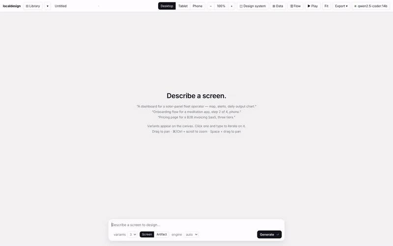
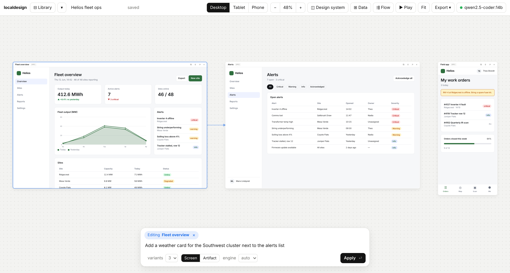
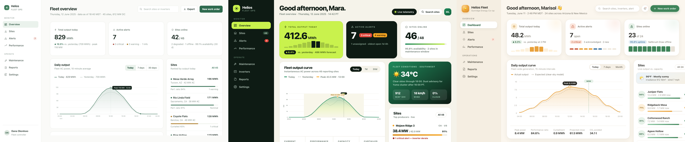
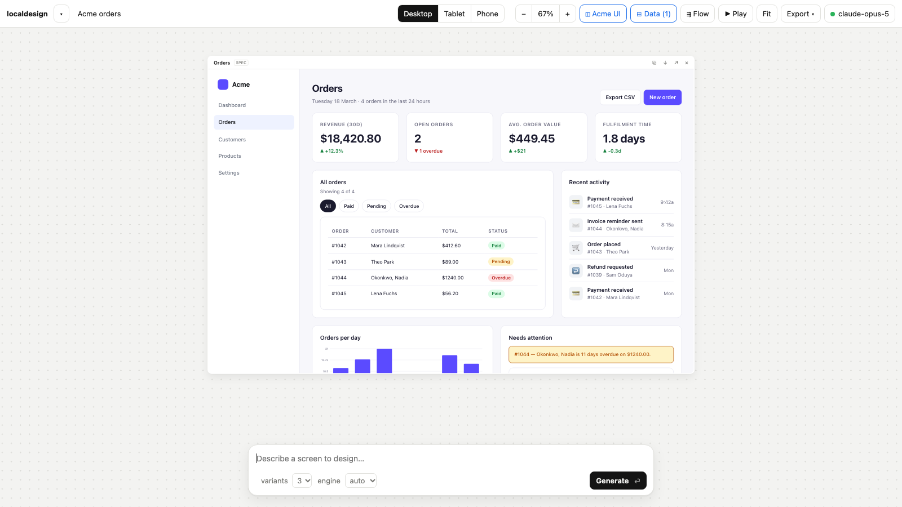
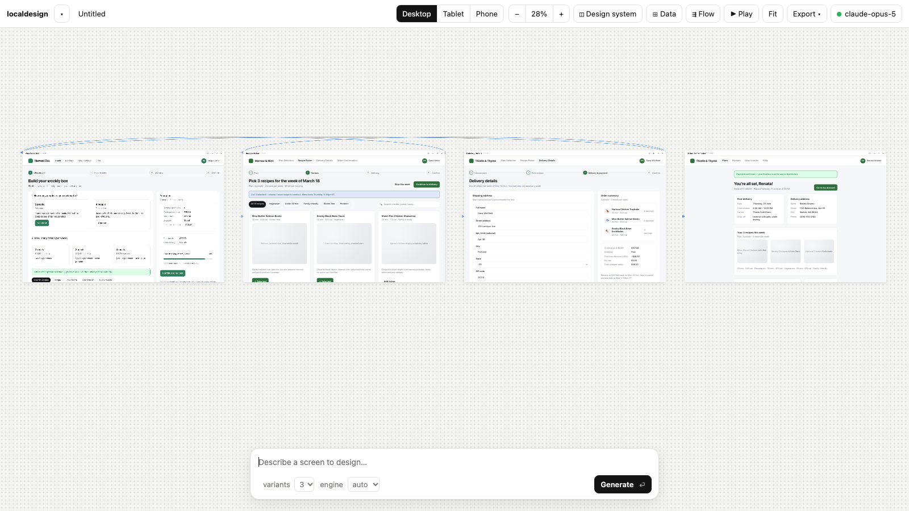
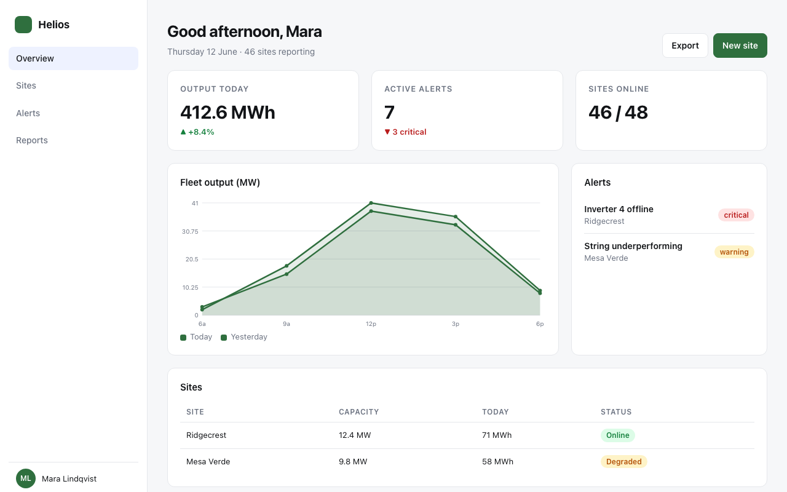
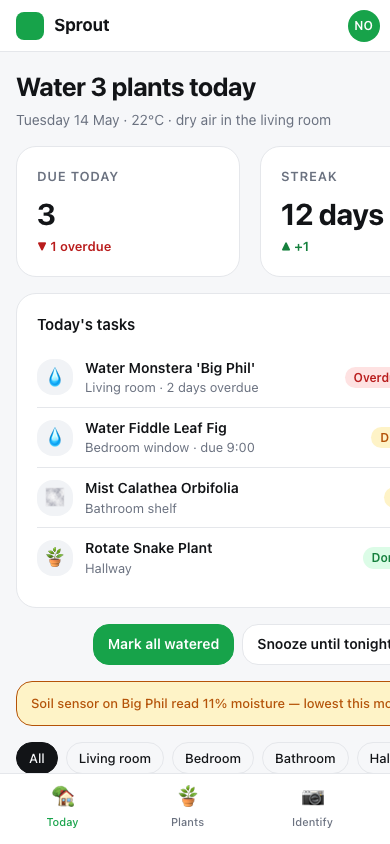
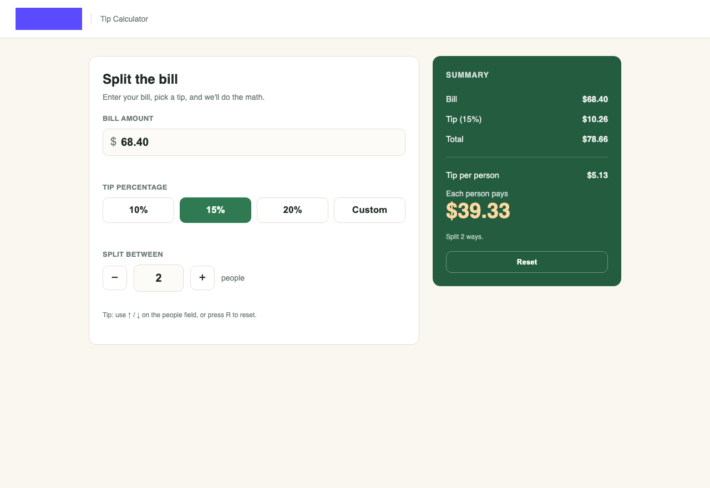
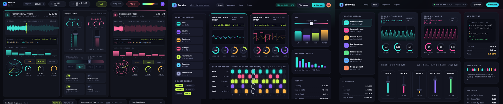

# localdesign

**AI design for teams whose work can't leave the building.**
Prompt → UI screens on an infinite canvas · edit by hand or by chat · runs offline on a 4–14B local model as well as on frontier APIs ·
generates in *your* design system · every model call audited · hands off an **implementation pack** a human or a small local model can build from.

One `pip install`, zero runtime dependencies (stdlib Python + vanilla JS), no Electron, no telemetry, no coding agent required.

[](https://github.com/ghanemja/localdesign/actions/workflows/ci.yml)
  


*Prompt → three design directions → iterate one by chat → Export ▾ → Implementation pack (with screenshots and a model-written overview).*

```bash
uv tool install localdesign        # or: pipx install localdesign / pip install localdesign
lde                                # → http://127.0.0.1:7878   (from a checkout: uv tool install --editable .)
```


*The app: screens on an infinite canvas, flow arrows between them, select one and describe a change. Here running on a local 14B model.*

## Why this exists

The prompt-to-UI tools of 2026 — Claude Design, Google Stitch, and the open-source Open Design — all assume a frontier model or a
coding agent is reachable. In government, healthcare, defence and many regulated enterprises it is not: the network is closed, the
only approved model is a 7B on an internal box, and every tool has to pass a security review. localdesign is built for that case first.

| | **localdesign** | Open Design | Dyad | Claude Design / Google Stitch |
|---|---|---|---|---|
| Runs with **no frontier model and no coding agent** | yes — spec engine for 4–14B models | no — drives Claude Code / Codex / Cursor or a BYOK API | partly — local models supported, but it builds apps, not design handoffs | no — cloud |
| Install surface | one wheel, **0 dependencies**, Python stdlib | Node daemon + an agent CLI | Electron app | SaaS |
| Fully offline / air-gapped | yes, by design ([how](#air-gapped-install)) | local UI, usually remote brains | with Ollama | no |
| Audit log of every model call | yes (`~/.localdesign/audit.jsonl`) | — | — | vendor-side |
| Your design system | CSS vars, Tailwind config, tokens JSON, HTML, a running site URL, **DESIGN.md** | DESIGN.md / skills | — | Stitch: DESIGN.md |
| Output | screens on a canvas, flows, artifacts, React, HTML, **implementation pack with VERIFY.md** | decks, images, video, prototypes | a working app | prototypes, code |
| Breadth, community | small, one maintainer | large (tens of thousands of stars) | large | large |

Pick Open Design or Dyad if you can run a frontier agent. Pick localdesign if you can't, or if "what exactly did the model see" has to be answerable.


*One prompt → three design directions. "Dashboard for a solar-panel fleet operator: left nav, KPI row, daily output chart, alerts table, site list."*

## What makes it different

| | localdesign | typical "Claude Design clone" |
|---|---|---|
| **Small local models** | *Spec engine*: the model writes a compact JSON layout, localdesign renders it with a built-in component library. A 4–8B model on Ollama produces consistent, finished screens. | Raw HTML from the model → small models produce broken pages |
| **Your design system** | Import CSS variables, `tailwind.config.js`, design-tokens JSON, a running site's URL, a **DESIGN.md** (Stitch format), or component snippets. Every screen uses your tokens; the HTML engine reuses your exact component markup. Export back to DESIGN.md for any agent that reads it. | Generic Tailwind soup |
| **Edit, don't regenerate** | Click any element: edit text inline, drag to reorder, resize, restyle, duplicate, delete, undo. Drag a block from variant B into variant A. Or select an element and tell the AI what to change about *just that*. | Regenerate the whole page and hope |
| **Component & asset library** | ⊟ Library: 30+ built-in components rendered live, plus *your* uploaded logos/icons/images and brand HTML snippets. Drag any of them onto any screen. Generated screens are told about your assets and use them; exports inline them as data URIs. | No palette, no brand assets |
| **Artifacts too** | Switch the prompt bar to **Artifact**: working single-file apps, calculators, charts, games, interactive docs — plain JS, no CDN. Same canvas, same editor, same exports. | Mockups only (or artifacts only) |
| **Flows, not screens** | Paste a journey or a PRD → planned screens → generated with navigation links → arrows on the canvas → ▶ Play the clickable prototype. | Isolated screens |
| **Real data** | Paste JSON/CSV → tables and lists use your actual rows. | Lorem ipsum |
| **Implementation pack** | Export ▾ → a zip of Markdown an engineer *or a small local model* can build from: `ARCHITECTURE.md` (inventory, navigation graph, inferred data model), `DESIGN_SYSTEM.md`, `FLOWS.md`, `DATA.md`, `IMPLEMENTATION_PLAN.md`, `AGENTS.md` (rules for the agent), `VERIFY.md` + `verify.sh` (grep-able checks the agent runs on its own work), `DESIGN.md`, per-screen docs with props, exact markup and verbatim copy, reference HTML + PNG, `tokens.css`, `components.css`, assets. Deterministic, offline; optionally a model-written overview. Built for teams (government, healthcare) that can't use frontier tooling. | HTML files |
| **Round trip** | In: PRD/ticket text. Out: design-spec Markdown, per-screen React (.jsx + .css), AI React + Tailwind, self-contained HTML. | HTML only |
| **Air-gap ready** | Stdlib Python server + vanilla JS, no CDN in generated output (optional), audit log of every model call, Origin/Host guard, works behind corporate proxies with any OpenAI-compatible endpoint. | Cloud or Electron |

## In pictures

**Generate in your design system, with your data.** Tokens imported from `:root` CSS; the orders table is a pasted CSV.


**Flows.** A one-line checkout description → four planned screens, generated with navigation links, arrows on the canvas, ▶ Play to click through.


**Spec engine.** The model wrote ~1.5 KB of JSON; localdesign rendered it. This is what makes 4–8B local models usable.

<p> </p>

**Artifacts.** "A tip calculator: bill amount, tip % buttons, split between N people" → a working app in one file, 41 s.


**Anything, not just dashboards.** "Create an app for a math-based DJ board", HTML engine, three directions.


## Backends

Anything that speaks the OpenAI chat-completions API — Ollama, LM Studio, llama.cpp server, vLLM,
an internal company gateway, OpenRouter, OpenAI, Groq — plus the Anthropic Messages API.

```bash
lde --provider ollama -m qwen2.5-coder:14b
lde --base-url https://llm.internal.corp/v1 -m our-model --api-key $TOKEN
LD_BASE_URL=http://10.0.0.5:8000/v1 LD_MODEL=Qwen/Qwen3-Coder-30B lde
lde --provider anthropic -m claude-opus-5
```

Or use **Settings** in the app: pick a preset, paste a base URL, **Fetch** the endpoint's models.
Config persists in `~/.localdesign/config.json` (keys stored in plaintext there — prefer env vars on shared machines).

### Engines

- **html** — the model writes the whole page. Best with strong models (Claude, GPT, 30B+ local).
- **spec** — the model writes a JSON layout spec (heading, stats, grid, table, chart, form, pricing, chat, timeline, … 30+ node types); localdesign renders it. 10–20× fewer output tokens, consistent styling, reliable with 4–14B local models. Progressive rendering while it streams.
- **auto** (default) — spec for local models under ~30B, html otherwise. Switch per generation in the prompt bar.

## Using it

- **Generate**: describe a screen → N variants (each with a different design direction) stream onto the canvas.
- **Iterate**: click a screen, type a change → new version in place (`v3` badge cycles versions).
- **Edit**: click inside a screen to select an element. Toolbar: text, style, ↑↓ reorder, duplicate, link, **✦ AI** (type a change for that element), delete. Double-click text to edit. Drag an element onto another screen to copy it there. ⌘Z undoes.
- **Library** (⊟): drag built-in components, your uploaded assets (logo, icons, product shots) or brand snippets onto a screen. Assets live in `~/.localdesign/assets/<project>/` and are served at `/assets/…`; HTML exports inline them.
- **Artifact** toggle (prompt bar): build an interactive app/tool/chart/game/document instead of a mockup. Iterate, edit and export it like any screen.
- **Desktop / Tablet / Phone**: sets the width for new screens; with a screen selected it resizes that screen (spec screens re-render in the phone layout; HTML screens reflow — ↻ regenerates at the new width).
- **Design system** (◫): paste `:root{…}` / tailwind config / tokens JSON / an HTML page, a **DESIGN.md**, or **fetch a running site** (page + its same-origin stylesheets → tokens); adjust tokens; add component snippets and guidelines. Spec screens re-render instantly with the new tokens.
- **Data** (⊞): paste JSON or CSV as a named source; mention it in briefs.
- **Flow** (⇶): describe a journey or paste a PRD → edit the planned screen list → generate all with links. Arrows show navigation; **▶ Play** runs the prototype.
- **Export ▾ → Implementation pack**: drop the unzipped folder into a repo as `design/` and tell your agent *"Read design/AGENTS.md and follow it."* Small-model prompts (one section at a time) are in `IMPLEMENTATION_PLAN.md`; when it says it is done, *"Run design/VERIFY.md and report pass/fail per line."* Options: per-screen PNG screenshots (needs Chrome, Chromium or Edge on the machine — `LD_CHROME=/path/to/chrome` to point at one), a model-written overview at the top of `ARCHITECTURE.md` (the only part of the pack that calls the model), and writing straight into a folder (e.g. `<repo>/design`) instead of downloading a zip.
- **Export ▾**: project JSON, design spec (.md), **DESIGN.md**, HTML, React (.jsx + .css, deterministic), React + Tailwind (AI), all screens at once.
- **Settings** (top right): pick a preset, **Fetch** the model list, **Test** (one tiny call proves endpoint, key and model). With no model configured the dialog opens by itself on first run.
- Canvas: drag to pan, ⌘/Ctrl+scroll to zoom, Space+drag, **Fit**, `/` focuses the prompt. Projects autosave to `~/.localdesign/projects/`.

## Air-gapped install

Nothing in localdesign needs the internet: the wheel has no dependencies, the app has no CDN or font calls, and the only outbound
traffic is to the model endpoint you configure. To move it onto a closed network:

```bash
# on a connected machine
pip download localdesign --no-deps -d localdesign-offline/          # one .whl, ~100 KB
ollama pull qwen2.5-coder:14b                                        # or any model your policy allows

# copy localdesign-offline/ and the Ollama model to the closed machine, then
pip install --no-index --find-links localdesign-offline/ localdesign
lde --provider ollama -m qwen2.5-coder:14b --no-open                 # or --base-url http://<internal-gateway>/v1
```

Ollama models live in `~/.ollama/models` (copy the `blobs/` and `manifests/` entries for the model, or use `ollama pull` through an
allow-listed mirror). vLLM / llama.cpp / LM Studio work the same way: anything with an OpenAI-compatible `/v1` endpoint.
Pack screenshots need a Chrome/Chromium/Edge binary on the machine (`LD_CHROME=/path` if it is not on `PATH`); everything else works without one.

What a reviewer will ask, answered: no runtime dependencies to scan; config and projects are plain JSON under `~/.localdesign/`;
every model call is recorded in `audit.jsonl` with endpoint, model, prompt size and the first 300 characters of the prompt;
the server binds to 127.0.0.1 and rejects foreign `Origin`/`Host` headers; API keys are stored in plaintext config (use `LD_API_KEY` instead on shared machines).

## Security & privacy

- Binds to 127.0.0.1. `--host 0.0.0.0` exposes it to your network (and your API quota) — only on trusted LANs, with `--allow-host <name>`.
- Requests from other origins are rejected (no CSRF against your config or key); unknown `Host` headers are rejected (DNS rebinding).
- Generated screens are self-contained HTML with inline CSS and no external resources unless you enable *Allow CDN*.
- `~/.localdesign/audit.jsonl` records every model call: when, which endpoint/model, prompt size, the first 300 chars of the user prompt, duration, result. Disable with `--no-audit`.
- Nothing phones home. The only network calls are to the model endpoint you configured.

## Model notes

| Model | html engine | spec engine |
|---|---|---|
| 4B general (gemma3:4b) | broken/thin pages, 2–3 min | coherent simple screens, ~1 min |
| 7–14B coder (qwen2.5-coder, devstral) | usable, slow | good — recommended local setup |
| 30B+ / hosted frontier | excellent, 30–60 s | excellent, 10–15 s |

Claude models: reasoning effort defaults to **low** for generation (deep thinking adds minutes of silent latency and doesn't improve mockups); change it in Settings.

## Development

```bash
pip install -e ".[dev]"
pytest                      # 139 tests: renderer, parsers, exports, server API against a mock model (no API key needed)
```

CI runs the suite on Linux, Windows and macOS × Python 3.10/3.12/3.13 and checks the built wheel ships the static app.

## Layout

```
localdesign/
  server.py        stdlib HTTP server: static app, SSE generation, projects, config, exports, guards, audit
  llm.py           streaming over urllib: OpenAI-compatible + Anthropic, thinking status, truncation detection
  prompts.py       html/spec/element/plan/export prompts, design-system + data context
  components.py    spec → HTML renderer and component library (30+ node types), JSON repair
  designsystem.py  CSS vars / tailwind config / tokens JSON / HTML / DESIGN.md → tokens; tokens → DESIGN.md
  export.py        HTML → React (.jsx + .css), project → design-spec Markdown
  pack.py          implementation pack: Markdown docs, VERIFY.md + verify.sh, DESIGN.md, reference HTML/PNG, css, assets
  config.py        presets, ~/.localdesign/config.json, LD_* env overrides
  static/          index.html · app.css · app.js (canvas app) · editor.js (in-frame editor shim)
```

MIT. Zero runtime dependencies. Python ≥ 3.10.
