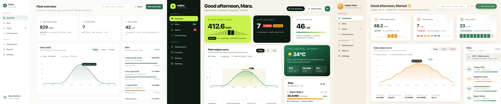
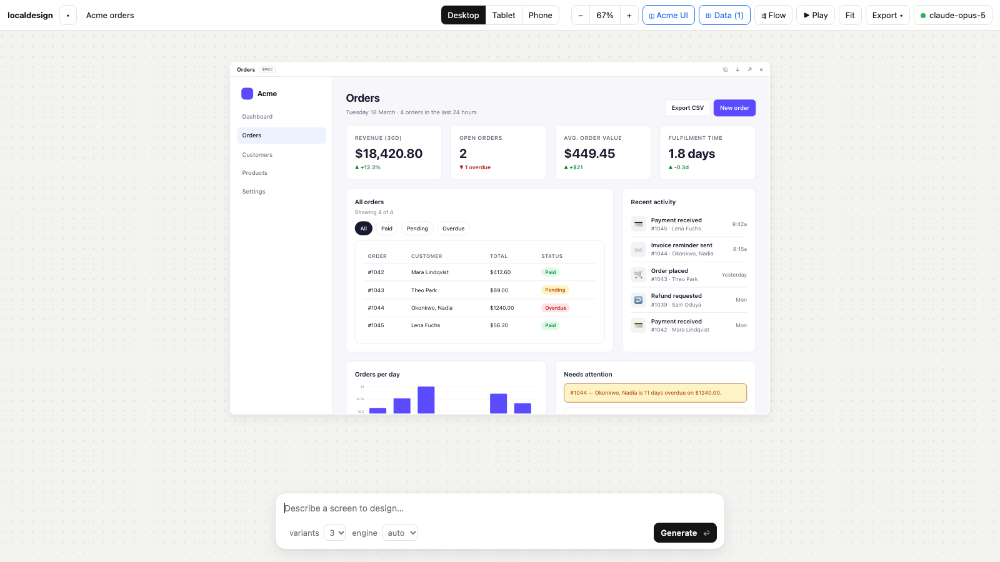
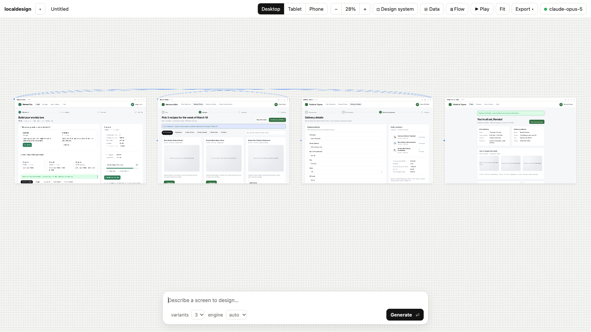
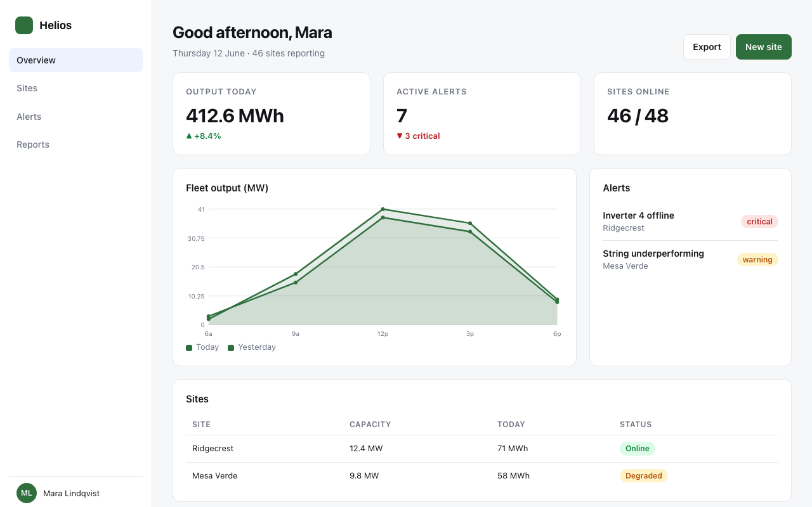
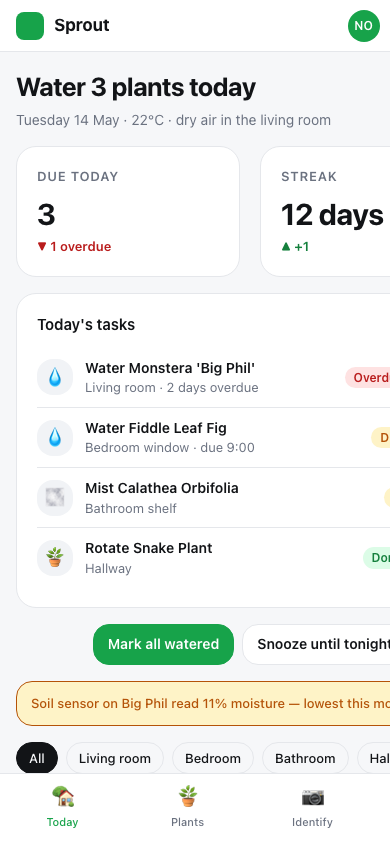
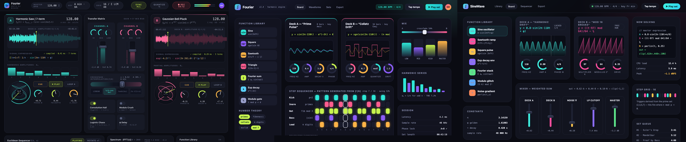

# localdesign

**The design tool for teams whose work can't leave the building.**
Prompt → UI screens on an infinite canvas · edit them by hand or by chat · works with any LLM,
including small local models · generates in *your* design system · zero dependencies, fully offline.

A local, provider-agnostic take on Claude Design. One `pip install`, one command, no Electron, no telemetry.

[](https://github.com/ghanemja/localdesign/actions/workflows/ci.yml)
  


*One prompt → three design directions. "Dashboard for a solar-panel fleet operator: left nav, KPI row, daily output chart, alerts table, site list."*

```bash
uv tool install --editable /path/to/localdesign      # or: pipx install . / pip install .
lde                                                  # → http://127.0.0.1:7878
```

## What makes it different

| | localdesign | typical "Claude Design clone" |
|---|---|---|
| **Small local models** | *Spec engine*: the model writes a compact JSON layout, localdesign renders it with a built-in component library. A 4–8B model on Ollama produces consistent, finished screens. | Raw HTML from the model → small models produce broken pages |
| **Your design system** | Import CSS variables, `tailwind.config.js`, design-tokens JSON, or component snippets. Every screen uses your tokens; the HTML engine reuses your exact component markup. | Generic Tailwind soup |
| **Edit, don't regenerate** | Click any element: edit text inline, drag to reorder, resize, restyle, duplicate, delete, undo. Drag a block from variant B into variant A. Or select an element and tell the AI what to change about *just that*. | Regenerate the whole page and hope |
| **Flows, not screens** | Paste a journey or a PRD → planned screens → generated with navigation links → arrows on the canvas → ▶ Play the clickable prototype. | Isolated screens |
| **Real data** | Paste JSON/CSV → tables and lists use your actual rows. | Lorem ipsum |
| **Round trip** | In: PRD/ticket text. Out: design-spec Markdown, per-screen React (.jsx + .css), AI React + Tailwind, self-contained HTML. | HTML only |
| **Air-gap ready** | Stdlib Python server + vanilla JS, no CDN in generated output (optional), audit log of every model call, Origin/Host guard, works behind corporate proxies with any OpenAI-compatible endpoint. | Cloud or Electron |

## In pictures

**Generate in your design system, with your data.** Tokens imported from `:root` CSS; the orders table is a pasted CSV.


**Flows.** A one-line checkout description → four planned screens, generated with navigation links, arrows on the canvas, ▶ Play to click through.


**Spec engine.** The model wrote ~1.5 KB of JSON; localdesign rendered it. This is what makes 4–8B local models usable.

<p> </p>

**Anything, not just dashboards.** "Create an app for a math-based DJ board", HTML engine, three directions.


## Backends

Anything that speaks the OpenAI chat-completions API — Ollama, LM Studio, llama.cpp server, vLLM,
an internal company gateway, OpenRouter, OpenAI, Groq — plus the Anthropic Messages API.

```bash
lde --provider ollama -m qwen2.5-coder:14b
lde --base-url https://llm.internal.corp/v1 -m our-model --api-key $TOKEN
LD_BASE_URL=http://10.0.0.5:8000/v1 LD_MODEL=Qwen/Qwen3-Coder-30B lde
lde --provider anthropic -m claude-opus-5
```

Or use **Settings** in the app: pick a preset, paste a base URL, **Fetch** the endpoint's models.
Config persists in `~/.localdesign/config.json` (keys stored in plaintext there — prefer env vars on shared machines).

### Engines

- **html** — the model writes the whole page. Best with strong models (Claude, GPT, 30B+ local).
- **spec** — the model writes a JSON layout spec (heading, stats, grid, table, chart, form, pricing, chat, timeline, … 30+ node types); localdesign renders it. 10–20× fewer output tokens, consistent styling, reliable with 4–14B local models. Progressive rendering while it streams.
- **auto** (default) — spec for local models under ~30B, html otherwise. Switch per generation in the prompt bar.

## Using it

- **Generate**: describe a screen → N variants (each with a different design direction) stream onto the canvas.
- **Iterate**: click a screen, type a change → new version in place (`v3` badge cycles versions).
- **Edit**: click inside a screen to select an element. Toolbar: text, style, ↑↓ reorder, duplicate, link, **✦ AI** (type a change for that element), delete. Double-click text to edit. Drag an element onto another screen to copy it there. ⌘Z undoes.
- **Design system** (◫): paste `:root{…}` / tailwind config / tokens JSON / an HTML page; adjust tokens; add component snippets and guidelines. Spec screens re-render instantly with the new tokens.
- **Data** (⊞): paste JSON or CSV as a named source; mention it in briefs.
- **Flow** (⇶): describe a journey or paste a PRD → edit the planned screen list → generate all with links. Arrows show navigation; **▶ Play** runs the prototype.
- **Export ▾**: project JSON, design spec (.md), HTML, React (.jsx + .css, deterministic), React + Tailwind (AI), all screens at once.
- Canvas: drag to pan, ⌘/Ctrl+scroll to zoom, Space+drag, **Fit**, `/` focuses the prompt. Projects autosave to `~/.localdesign/projects/`.

## Security & privacy

- Binds to 127.0.0.1. `--host 0.0.0.0` exposes it to your network (and your API quota) — only on trusted LANs, with `--allow-host <name>`.
- Requests from other origins are rejected (no CSRF against your config or key); unknown `Host` headers are rejected (DNS rebinding).
- Generated screens are self-contained HTML with inline CSS and no external resources unless you enable *Allow CDN*.
- `~/.localdesign/audit.jsonl` records every model call: when, which endpoint/model, prompt size, the first 300 chars of the user prompt, duration, result. Disable with `--no-audit`.
- Nothing phones home. The only network calls are to the model endpoint you configured.

## Model notes

| Model | html engine | spec engine |
|---|---|---|
| 4B general (gemma3:4b) | broken/thin pages, 2–3 min | coherent simple screens, ~1 min |
| 7–14B coder (qwen2.5-coder, devstral) | usable, slow | good — recommended local setup |
| 30B+ / hosted frontier | excellent, 30–60 s | excellent, 10–15 s |

Claude models: reasoning effort defaults to **low** for generation (deep thinking adds minutes of silent latency and doesn't improve mockups); change it in Settings.

## Development

```bash
pip install -e ".[dev]"
pytest                      # 113 tests: renderer, parsers, exports, server API against a mock model (no API key needed)
```

CI runs the suite on Linux, Windows and macOS × Python 3.10/3.12/3.13 and checks the built wheel ships the static app.

## Layout

```
localdesign/
  server.py        stdlib HTTP server: static app, SSE generation, projects, config, exports, guards, audit
  llm.py           streaming over urllib: OpenAI-compatible + Anthropic, thinking status, truncation detection
  prompts.py       html/spec/element/plan/export prompts, design-system + data context
  components.py    spec → HTML renderer and component library (30+ node types), JSON repair
  designsystem.py  CSS vars / tailwind config / tokens JSON / HTML → tokens
  export.py        HTML → React (.jsx + .css), project → design-spec Markdown
  config.py        presets, ~/.localdesign/config.json, LD_* env overrides
  static/          index.html · app.css · app.js (canvas app) · editor.js (in-frame editor shim)
```

MIT. Zero runtime dependencies. Python ≥ 3.10.
